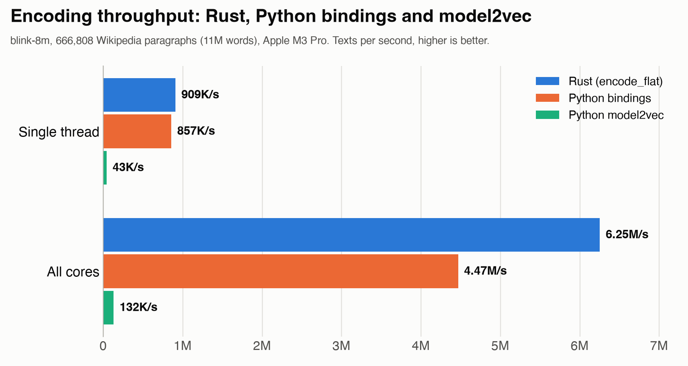

# model2vec-rs (Python)

Python bindings for [model2vec-rs](https://github.com/MinishLab/model2vec-rs), the Rust implementation of [Model2Vec](https://github.com/MinishLab/model2vec).

## Installation

```bash
pip install maturin
maturin develop --release   # from this directory
```

## Usage

```python
from model2vec_rs import StaticModel

model = StaticModel.from_pretrained("minishlab/potion-base-8M")

embeddings = model.encode(["Hello world", "Rust is awesome"])  # np.ndarray, shape (2, dim)
embedding = model.encode("Hello world")                        # np.ndarray, shape (dim,)

model.dim  # int
model.normalize  # bool, whether encode L2-normalizes by default
model.max_length  # int | None, the default max tokens per sentence for encode
```

`encode` accepts `max_length` (default: the model's `max_length`, `None` for no limit), `batch_size` (default `None`, which encodes all sentences in one parallel pass) and `normalize` (default `None`, which uses the model's setting), and releases the GIL while encoding.

As in `model2vec`, the model's `max_length` comes from its config (512 if unset, `null` for no limit). Override it with `StaticModel.from_pretrained(..., max_length=...)`; `from_arrays` defaults to 512.

### Loading from arrays

`from_arrays` builds a model from a tokenizer JSON string and NumPy arrays you have already loaded:

```python
import numpy as np
from model2vec_rs import StaticModel

tokenizer = open("tokenizer.json").read()
embeddings = np.load("embeddings.npy")  # float32 or int8, shape (rows, dim)

model = StaticModel.from_arrays(tokenizer, embeddings, normalize=True)
```

C-contiguous `embeddings` and `weights` are shared with the model instead of copied, so building a model doesn't duplicate the embedding table in memory. The model keeps the arrays alive, and they must not be modified while the model exists: in-place changes, such as `embeddings /= norms`, change the model's output. Pass a copy (`embeddings.copy()`) if you need to keep modifying the original. Arrays that are not C-contiguous, such as Fortran-ordered or strided arrays, and `token_mapping` are copied.

## Performance

We encoded the same 666,808 Wikipedia paragraphs (11M words) with [`blink-8m`](https://huggingface.co/minishlab/blink-8m) using the Rust crate, these bindings, and Python [`model2vec`](https://github.com/MinishLab/model2vec):

<p align="center">
  
</p>

On a single thread the bindings are about as fast as Rust and roughly **24×** faster than `model2vec`; on all cores they are roughly **38×** faster than `model2vec`.

To reproduce (from the repository root):

```bash
uv run --with ./python scripts/python_compare.py --model minishlab/blink-8m --bindings --rust-api flat --no-python-multiprocessing --out bindings.json
uv run scripts/bindings_chart.py bindings.json
```

Measured on an Apple M3 Pro with 5 alternating rounds per implementation, 5 timed passes each; throughput is the median over all passes. As in the [main benchmark](https://github.com/MinishLab/model2vec-rs#performance), `model2vec` runs with `use_multiprocessing=False`, which is faster than its default process pool. See [`scripts/python_compare.py`](https://github.com/MinishLab/model2vec-rs/blob/main/scripts/python_compare.py) for the options.
