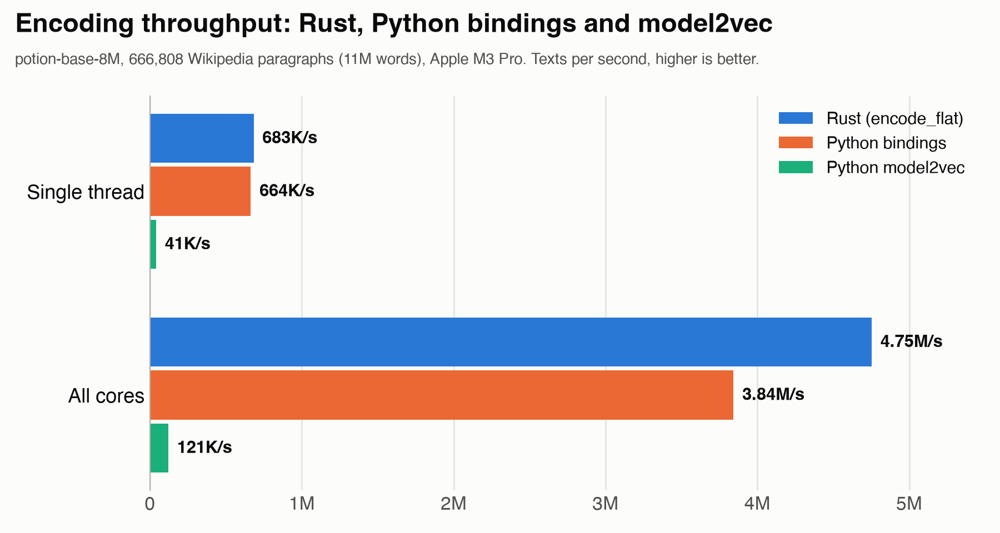

# model2vec-rs (Python)

Python bindings for [model2vec-rs](https://github.com/MinishLab/model2vec-rs), the Rust implementation of [Model2Vec](https://github.com/MinishLab/model2vec).

## Installation

```bash
pip install maturin
maturin develop --release   # from this directory
```

## Usage

```python
from model2vec_rs import StaticModel

model = StaticModel.from_pretrained("minishlab/potion-base-8M")

embeddings = model.encode(["Hello world", "Rust is awesome"])  # np.ndarray, shape (2, dim)
embedding = model.encode("Hello world")                        # np.ndarray, shape (dim,)

model.dim  # int
```

`encode` accepts `max_length` (default `512`, `None` for no limit) and `batch_size` (default `None`, which encodes all sentences in one parallel pass), and releases the GIL while encoding.

## Performance

We encoded the same 666,808 Wikipedia paragraphs (11M words) with [`potion-base-8M`](https://huggingface.co/minishlab/potion-base-8M) using the Rust crate, these bindings, and Python [`model2vec`](https://github.com/MinishLab/model2vec):

<p align="center">
  
</p>

On a single thread the bindings are about as fast as Rust and roughly **16×** faster than `model2vec`; on all cores they are roughly **32×** faster than `model2vec`.

To reproduce (from the repository root):

```bash
uv run --with ./python scripts/python_compare.py --bindings --rust-api flat --no-python-multiprocessing --out bindings.json
uv run scripts/bindings_chart.py bindings.json
```

Measured on an Apple M3 Pro with 5 alternating rounds per implementation, 5 timed passes each; throughput is the median over all passes. As in the [main benchmark](https://github.com/MinishLab/model2vec-rs#performance), `model2vec` runs with `use_multiprocessing=False`, which is faster than its default process pool. See [`scripts/python_compare.py`](https://github.com/MinishLab/model2vec-rs/blob/main/scripts/python_compare.py) for the options.
